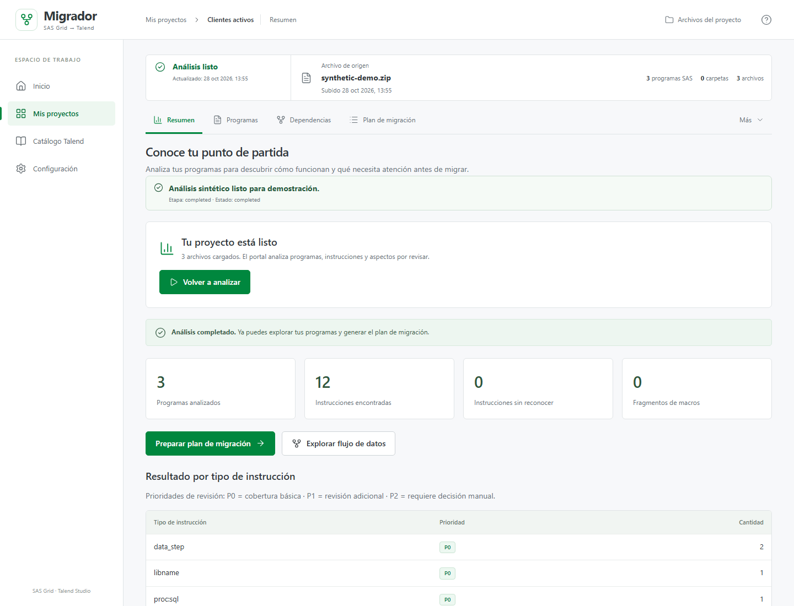
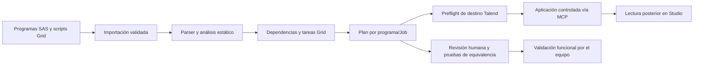

<div align="center">

# SAS Grid Migrator

**Analiza programas SAS 9.4 y prepara guías trazables para migrarlos a Talend Studio.**


[Empezar](#empezar) · [Qué hace](#qué-hace) · [Flujo](#cómo-funciona) · [Estado](#estado-del-proyecto) · [Documentación](#documentación)

</div>

SAS Grid Migrator inspecciona código SAS de forma estática y produce inventarios, dependencias y
planes de construcción por Job, con evidencia de archivo y línea. El portal puede enviar esos planes
a **talend-mcp** para crear o actualizar Jobs en Talend Studio, sujeto a revisión y a los controles
de escritura del proyecto.

> **No es un conversor automático ni un motor de ejecución.** No ejecuta SAS, macros ni scripts
> importados; tampoco ejecuta, compila ni publica Jobs Talend. Los planes son una propuesta técnica:
> la equivalencia de resultados debe comprobarla una persona con datos de prueba.

<p align="center">
  
  <br>
  <em>Resumen de un proyecto de demostración con datos sintéticos.</em>
</p>

## Qué hace

- **Inventaría y analiza** programas SAS, macros, sentencias y evidencia para revisión P0/P1/P2.
- **Construye dependencias** entre programas y datasets e infiere tareas y secuencias SAS Grid.
- **Prepara un plan por programa/Job** con componentes candidatos, propiedades, conexiones y
  decisiones pendientes; exporta JSON, Markdown y CSV.
- **Conserva lo desconocido como pendiente.** No inventa esquemas, credenciales, valores ni
  equivalencias que el código fuente no demuestra.
- **Integra con Talend mediante MCP.** Antes de escribir, el portal revisa destinos y conflictos; la
  operación no ejecuta los Jobs creados.
- **Permite ajustar el plan sin perder lo automático.** El nombre y la descripción del Job, las
  expresiones traducidas y los renombrados en lote se guardan como capas sobre el plan generado; el
  archivo del plan no se reescribe con esas ediciones.
- **Muestra qué sigue y qué falta.** El resumen del proyecto trae etapas, la siguiente acción y los
  pendientes agrupados; `#/traductor` permite probar una expresión SAS aislada.

## Empezar

### Requisitos

- Python **3.12 o posterior** y [uv](https://docs.astral.sh/uv/).
- [Bun](https://bun.sh/) para la interfaz web y el servidor MCP, si se inicia el entorno completo.
- Talend Studio **8.0.1** con el Bridge instalado, solo para crear o actualizar Jobs en Studio.

El análisis estático y las pruebas Python funcionan sin SAS ni Talend Studio.

### Instalar y ejecutar

Desde la raíz del repositorio:

```bash
uv sync
```

Instala las dependencias del MCP y la web una vez:

```bash
# MCP
cd mcp/talend-mcp
bun install

# Regresa a la raíz y prepara la web
cd ../..
cd apps/web
bun install
```

Arranca la plataforma local:

```bash
uv run sgm dev
```

La API queda en `http://127.0.0.1:8000`, la web en `http://127.0.0.1:5173` y el MCP local en
`http://127.0.0.1:3927/mcp`. El comando usa el preset `portal` y no reinstala el Bridge de un Studio
abierto. Para iniciar solo API y web cuando el MCP ya corre aparte, usa `uv run sgm dev --no-mcp`.

### Analizar un lote desde la CLI

```bash
uv run sgm import tests/fixtures/sas -n corpus
uv run sgm inventory <project_id>
uv run sgm analyze <project_id>
uv run sgm deps <project_id>
uv run sgm plan <project_id> -o ./salida
```

La CLI informa el identificador del proyecto al importarlo. `plan` genera guías por Job y los
archivos de salida `index.md` y `steps.csv`.

### Automatizar desde un agente

`sgm agent api` llama a la API y devuelve JSON. `sgm agent migrate` importa un proyecto, espera las
etapas de análisis, dependencias y planes, y solicita las exportaciones; **no aplica Jobs en Talend**.

```bash
uv run sgm agent api GET /projects
uv run sgm agent api POST /projects --data '{"name":"clientes"}'
uv run sgm agent migrate ./lote_sas --name clientes
```

Para otra API, usa `--server URL` o define `SGM_API`. La ruta pasada a `agent migrate` debe ser
accesible desde la máquina donde corre la API. Para usar una API remota, sube el ZIP por la UI o por
un endpoint multipart.

## Cómo funciona



Los ZIP subidos desde la UI crean proyectos aislados y procesan en segundo plano tres etapas:
análisis SAS, dependencias y guías. Consulta el estado de procesamiento; si una etapa falla o el
servidor se reinicia, el proyecto queda disponible para inspección y reintento. Los límites de
importación, cola y concurrencia se documentan en la [guía de proyectos ZIP](docs/zip-project-workspaces.md).

La aplicación de Jobs es una acción separada desde el proyecto. El portal consulta el inventario de
Studio, bloquea conflictos de nombre/carpeta y vuelve a comprobar el destino antes de escribir. El
permiso se administra en **Configuración** y se guarda en SQLite. Los detalles sin resolver pasan al
Job como contexto pendiente; no se completan con valores supuestos.

## Estado del proyecto

El siguiente corte corresponde al piloto de **50 programas de repositorios con licencia permisiva y
8 fixtures sintéticas**, no a un entorno productivo ni a código de un cliente:

| Medición del piloto | Resultado |
|---|---:|
| Programas analizados / planes generados | 50 / 50 |
| Pasos de plan | 2.483 |
| Jobs propuestos / requieren revisión | 2 / 48 |
| Pasos con pendientes de migración | 2.261 (91 %) |
| Pasos sin componente determinado | 878 (35 %) |

Los pendientes reflejan principalmente información de entorno que no está en el SAS —esquemas,
formatos físicos, motores, credenciales y equivalencia funcional— y deben resolverse con el equipo
responsable. Las cifras y sus limitaciones están en el [informe de piloto](docs/pilot-report.md).

La cobertura de Talend no se infiere del nombre de un componente: requiere verificación en Studio y
pruebas de equivalencia. Consulta el [plan de pruebas de componentes](docs/talend-component-migration-tests.md)
y el [procedimiento de equivalencia SAS ↔ Talend](docs/equivalence-testing.md).

## Documentación

| Quieres... | Consulta |
|---|---|
| Entender el flujo y encontrar código y pruebas | [Guía para agentes](docs/agent-guide.md) |
| Operar proyectos ZIP, reintentos y lotes Talend | [Proyectos aislados por ZIP](docs/zip-project-workspaces.md) |
| Revisar arquitectura y límites por capa | [Arquitectura](docs/architecture.md) |
| Consultar seguridad y límites de importación | [Seguridad](docs/security.md) |
| Ver cobertura y limitaciones del parser SAS | [Soporte SAS Grid](docs/sas-grid-support.md) |
| Conocer resultados y alcance del piloto | [Informe de piloto](docs/pilot-report.md) |
| Validar equivalencia con datos de prueba | [Pruebas de equivalencia](docs/equivalence-testing.md) |
| Revisar mappings de componentes Talend | [Pruebas de componentes](docs/talend-component-migration-tests.md) |
| Explorar rutas de la API | `http://127.0.0.1:8000/docs` y `/openapi.json` |

## Desarrollo

```bash
uv run pytest
uv run ruff check src tests
```

Para la web:

```bash
cd apps/web
bun test
bun run typecheck
bun run build
```

Para el MCP:

```bash
cd mcp/talend-mcp
bun test
bun run typecheck
```

El mapa del repositorio y las reglas de trabajo están en [AGENTS.md](AGENTS.md). Antes de cambiar
el subtree `mcp/talend-mcp/`, sigue también sus [instrucciones de agentes](mcp/talend-mcp/AGENTS.md).

## Configuración

La API lee configuración del entorno. Los valores predeterminados son para desarrollo local:

| Variable | Uso | Predeterminado |
|---|---|---|
| `SGM_DATA_DIR` | SQLite, proyectos y artefactos generados | `./data` |
| `SGM_API` | URL que usa la CLI de agentes | `http://127.0.0.1:8000` |
| `SGM_MAX_FILE_BYTES` | Límite por archivo extraído | `5 MiB` |
| `SGM_MAX_FILES` | Máximo de archivos importados | `5.000` |
| `SGM_MAX_TOTAL_BYTES` | Límite de tamaño del ZIP recibido | `256 MiB` |
| `SGM_IMPORT_ROOTS` | Rutas permitidas para importación desde el servidor | Sin restricción adicional |
| `SGM_MAX_PIPELINE_CONCURRENCY` | Pipelines de análisis activos por proceso | `2` |
| `SGM_MAX_QUEUED_PIPELINES` | Solicitudes de análisis en cola por proceso | `20` |
| `TALEND_MCP_URL` | Endpoint HTTP del servidor MCP | `http://127.0.0.1:3927/mcp` |
| `TALEND_MCP_TIMEOUT_SECONDS` | Timeout de llamadas al MCP | `60` |
| `TALEND_APPLY_FOLDER` | Carpeta raíz permitida para nuevos Jobs | `Process/PruebasWebSAS` |

Consulta [`.env.example`](.env.example) para la lista vigente. La API no tiene autenticación:
mantenla en loopback y no la expongas directamente a Internet. Para despliegue local persistente,
consulta [ops/systemd](ops/systemd/README.md).

## Solución de problemas

| Síntoma | Qué revisar |
|---|---|
| No carga la interfaz o la API | API en puerto `8000`, UI en `5173`; revisa la consola del navegador. |
| El pipeline sigue en cola o fue interrumpido | Consulta el estado del proyecto; revisa límites por proceso y reintenta si corresponde. |
| No conecta con el MCP | `TALEND_MCP_URL`, proceso MCP y puerto local `3927`. |
| No se puede escribir en Talend | Permiso en Configuración, preflight, conflictos de destino, Studio abierto y Bridge disponible. |
| Un Job aparece con pendientes | Es deliberado cuando faltan datos o validación; completa el contexto y compara resultados con SAS. |

No reinstales ni recargues el Bridge mientras haya Jobs o diálogos abiertos en Studio. Para revisar
configuración y diagnóstico operativo, consulta la [guía de proyectos ZIP](docs/zip-project-workspaces.md).
