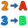
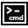

# Job `job_runall`

- **Programa SAS:** `real/ts-sas-legacy-analytics/Macro/RunAll.sas` (sha256 `9139cf6111a0`)
- **Instrucciones:** 26 · **Reglas:** v1
- **Aviso:** los esquemas y propiedades son candidatos derivados de fuentes comunitarias. El enlace oficial solo acredita la referencia documental; `verificado` requiere contraste con un Job real.

## Variables de contexto

- `context.data` ← SAS `data` (&data en real/ts-sas-legacy-analytics/Macro/RunAll.sas:120)

## Pasos

## Definición de macro auxiliar `%RunAll`(data, debug)

### 1. Mantenimiento de datasets

- **Acción:** add_component · **Componente:** `tDBRow` (sin verificar) · alternativas: `ninguno`
- **Subjob:** `m:RunAll:s115` · **Confianza:** low · **Origen SAS:** `real/ts-sas-legacy-analytics/Macro/RunAll.sas:115`
- **Propiedades:**
  - `QUERY` = _por configurar_ — regla mappings
- **Pendientes:**
  - Decidir si la operación de mantenimiento aplica en el destino

### 2. Leer &data

- **Acción:** add_component · **Componente:** `por_determinar` (sin verificar) · alternativas: `tFileInputDelimited`, `tDBInput`
- **Subjob:** `m:RunAll:s120` · **Confianza:** high · **Origen SAS:** `real/ts-sas-legacy-analytics/Macro/RunAll.sas:120`
- **Conexiones:** OnSubjobOk desde `m:RunAll:op_115_maintenance_1`
- **Propiedades:**
  - `TABLE` = `&data` — SAS real/ts-sas-legacy-analytics/Macro/RunAll.sas:120
  - `QUERY` = _por configurar_ — regla mappings
  - `CONNECTION` = _por configurar_ — regla mappings
- **Pendientes:**
  - Formato físico o sistema de origen del dataset
  - Esquema y tipos de columnas
  - Librería o sistema de origen no determinable (nombre dinámico)
- **Pruebas:** `vc_m:RunAll:op_120_read_1_row_count`, `vc_m:RunAll:op_120_read_1_schema`

### 3. Ordenar por group, program

- **Acción:** add_component · **Componente:** `tSortRow`  (sin verificar)
- **Subjob:** `m:RunAll:s120` · **Confianza:** high · **Origen SAS:** `real/ts-sas-legacy-analytics/Macro/RunAll.sas:120`
- **Referencia:** [documentación](https://help.qlik.com/talend/en-US/components/8.0/processing/tsortrow-standard-properties)
- **Conexiones:** Main desde `m:RunAll:op_120_read_1`
- **Propiedades:**
  - `CRITERIA` (Criteria) = `group, program` — SAS real/ts-sas-legacy-analytics/Macro/RunAll.sas:120 · nombre oficial
- **Esquema:** `group`, `program` _(tipos por determinar)_
- **Pruebas:** `vc_m:RunAll:op_120_sort_1_ordering`

### 4. Escribir &data

- **Acción:** add_component · **Componente:** `por_determinar` (sin verificar) · alternativas: `tFileOutputDelimited`, `tDBOutput`
- **Subjob:** `m:RunAll:s120` · **Confianza:** high · **Origen SAS:** `real/ts-sas-legacy-analytics/Macro/RunAll.sas:120`
- **Conexiones:** Main desde `m:RunAll:op_120_sort_1`
- **Propiedades:**
  - `TABLE` = `&data` — SAS real/ts-sas-legacy-analytics/Macro/RunAll.sas:120
  - `TABLE_ACTION` = `DROP_CREATE` — SAS real/ts-sas-legacy-analytics/Macro/RunAll.sas:120
  - `DATA_ACTION` = `INSERT` — SAS real/ts-sas-legacy-analytics/Macro/RunAll.sas:120
  - `CONNECTION` = _por configurar_ — regla mappings
- **Pendientes:**
  - Sistema y tabla/archivo de destino
  - Librería o sistema de origen no determinable (nombre dinámico)
  - Confirmar la acción sobre la tabla: SAS reemplaza el dataset completo
- **Pruebas:** `vc_m:RunAll:op_120_write_1_row_count`, `vc_m:RunAll:op_120_write_1_schema`

### 5. Leer &data

- **Acción:** add_component · **Componente:** `por_determinar` (sin verificar) · alternativas: `tFileInputDelimited`, `tDBInput`
- **Subjob:** `m:RunAll:s125` · **Confianza:** high · **Origen SAS:** `real/ts-sas-legacy-analytics/Macro/RunAll.sas:125`
- **Conexiones:** OnSubjobOk desde `m:RunAll:op_120_write_1`
- **Propiedades:**
  - `TABLE` = `&data` — SAS real/ts-sas-legacy-analytics/Macro/RunAll.sas:125
  - `QUERY` = _por configurar_ — regla mappings
  - `CONNECTION` = _por configurar_ — regla mappings
- **Pendientes:**
  - Formato físico o sistema de origen del dataset
  - Esquema y tipos de columnas
  - Librería o sistema de origen no determinable (nombre dinámico)
- **Pruebas:** `vc_m:RunAll:op_125_read_1_row_count`, `vc_m:RunAll:op_125_read_1_schema`

### 6. Calcular columnas (asignaciones y condicionales)

- **Acción:** add_component · **Componente:** `tMap`  (sin verificar) · alternativas: `tJavaRow`
- **Subjob:** `m:RunAll:s125` · **Confianza:** medium · **Origen SAS:** `real/ts-sas-legacy-analytics/Macro/RunAll.sas:125`
- **Referencia:** [documentación](https://help.qlik.com/talend/en-US/components/8.0/tmap/tmap-standard-properties)
- **Conexiones:** Main desde `m:RunAll:op_125_read_1`
- **Propiedades:**
  - `Expressions` (Editor del componente (no es un parámetro plano)) = `2 asignaciones, 1 condicionales` — SAS real/ts-sas-legacy-analytics/Macro/RunAll.sas:125
  - `Var table` (Editor del componente (no es un parámetro plano)) = _por configurar_ — regla mappings
- **Esquema:** `pos`, `basename` _(tipos por determinar)_
- **Expresión** (línea 128): SAS `findc(program,"&fs",-1000)` → _sin traducción automática_
  - ⚠ Sin traducción automática: función findc
- **Expresión** (línea 130): SAS `substr(program,pos+1)` → _sin traducción automática_
  - ⚠ Sin traducción automática: función substr
- **Expresión** (línea 129): SAS `if pos then path=substr(program,1,pos-1)` → _sin traducción automática_
  - ⚠ Condicional IF/ELSE: traducir a expresión ternaria o bloque de tMap/tJavaRow
- **Supuestos:** Lógica condicional: revisar orden de evaluación y valores missing
- **Pendientes:**
  - Tipos de las columnas calculadas
- **Pruebas:** `vc_m:RunAll:op_125_compute_1_nulls`, `vc_m:RunAll:op_125_compute_1_dates`, `vc_m:RunAll:op_125_compute_1_numeric`

### 7. Escribir &data

- **Acción:** add_component · **Componente:** `por_determinar` (sin verificar) · alternativas: `tFileOutputDelimited`, `tDBOutput`
- **Subjob:** `m:RunAll:s125` · **Confianza:** high · **Origen SAS:** `real/ts-sas-legacy-analytics/Macro/RunAll.sas:125`
- **Conexiones:** Main desde `m:RunAll:op_125_compute_1`
- **Propiedades:**
  - `TABLE` = `&data` — SAS real/ts-sas-legacy-analytics/Macro/RunAll.sas:125
  - `TABLE_ACTION` = `DROP_CREATE` — SAS real/ts-sas-legacy-analytics/Macro/RunAll.sas:125
  - `DATA_ACTION` = `INSERT` — SAS real/ts-sas-legacy-analytics/Macro/RunAll.sas:125
  - `CONNECTION` = _por configurar_ — regla mappings
- **Pendientes:**
  - Sistema y tabla/archivo de destino
  - Librería o sistema de origen no determinable (nombre dinámico)
  - Confirmar la acción sobre la tabla: SAS reemplaza el dataset completo
- **Pruebas:** `vc_m:RunAll:op_125_write_1_row_count`, `vc_m:RunAll:op_125_write_1_schema`

### 8. Leer &data

- **Acción:** add_component · **Componente:** `por_determinar` (sin verificar) · alternativas: `tFileInputDelimited`, `tDBInput`
- **Subjob:** `m:RunAll:s140` · **Confianza:** high · **Origen SAS:** `real/ts-sas-legacy-analytics/Macro/RunAll.sas:141`
- **Conexiones:** OnSubjobOk desde `m:RunAll:op_125_write_1`
- **Propiedades:**
  - `TABLE` = `&data` — SAS real/ts-sas-legacy-analytics/Macro/RunAll.sas:141
  - `QUERY` = _por configurar_ — regla mappings
  - `CONNECTION` = _por configurar_ — regla mappings
- **Pendientes:**
  - Formato físico o sistema de origen del dataset
  - Esquema y tipos de columnas
  - Librería o sistema de origen no determinable (nombre dinámico)
- **Pruebas:** `vc_m:RunAll:op_141_read_1_row_count`, `vc_m:RunAll:op_141_read_1_schema`

### 9. Seleccionar/calcular columnas

- **Acción:** add_component · **Componente:** `tMap`  (sin verificar)
- **Subjob:** `m:RunAll:s140` · **Confianza:** high · **Origen SAS:** `real/ts-sas-legacy-analytics/Macro/RunAll.sas:141`
- **Referencia:** [documentación](https://help.qlik.com/talend/en-US/components/8.0/tmap/tmap-standard-properties)
- **Conexiones:** Main desde `m:RunAll:op_141_read_1`
- **Propiedades:**
  - `Output columns` (Editor del componente (no es un parámetro plano)) = `status` — SAS real/ts-sas-legacy-analytics/Macro/RunAll.sas:141
  - `Expressions` (Editor del componente (no es un parámetro plano)) = _por configurar_ — regla mappings
- **Esquema:** `status` _(tipos por determinar)_
- **Pruebas:** `vc_m:RunAll:op_141_project_1_schema`

### 10. Asignar variable desde datos

- **Acción:** add_component · **Componente:** `tSetGlobalVar`  (sin verificar) · alternativas: `tJava`, `tFlowToIterate`
- **Subjob:** `m:RunAll:s140` · **Confianza:** medium · **Origen SAS:** `real/ts-sas-legacy-analytics/Macro/RunAll.sas:141`
- **Referencia:** [documentación](https://help.qlik.com/talend/en-US/components/8.0/global-variable/tsetglobalvar)
- **Conexiones:** Main desde `m:RunAll:op_141_project_1`
- **Propiedades:**
  - `VARIABLES` (Variables) = `KEY=status_vars separated by " "` — SAS real/ts-sas-legacy-analytics/Macro/RunAll.sas:141 · nombre oficial
- **Pendientes:**
  - Origen del valor y alcance de la variable

### 11. Leer &data

- **Acción:** add_component · **Componente:** `por_determinar` (sin verificar) · alternativas: `tFileInputDelimited`, `tDBInput`
- **Subjob:** `m:RunAll:s155` · **Confianza:** high · **Origen SAS:** `real/ts-sas-legacy-analytics/Macro/RunAll.sas:155`
- **Conexiones:** OnSubjobOk desde `m:RunAll:op_141_set_variable_1`
- **Propiedades:**
  - `TABLE` = `&data` — SAS real/ts-sas-legacy-analytics/Macro/RunAll.sas:155
  - `QUERY` = _por configurar_ — regla mappings
  - `CONNECTION` = _por configurar_ — regla mappings
- **Pendientes:**
  - Formato físico o sistema de origen del dataset
  - Esquema y tipos de columnas
  - Librería o sistema de origen no determinable (nombre dinámico)
- **Pruebas:** `vc_m:RunAll:op_155_read_1_row_count`, `vc_m:RunAll:op_155_read_1_schema`

### 12. Leer &data

- **Acción:** add_component · **Componente:** `por_determinar` (sin verificar) · alternativas: `tFileInputDelimited`, `tDBInput`
- **Subjob:** `m:RunAll:s155` · **Confianza:** high · **Origen SAS:** `real/ts-sas-legacy-analytics/Macro/RunAll.sas:155`
- **Propiedades:**
  - `TABLE` = `&data` — SAS real/ts-sas-legacy-analytics/Macro/RunAll.sas:155
  - `QUERY` = _por configurar_ — regla mappings
  - `CONNECTION` = _por configurar_ — regla mappings
- **Pendientes:**
  - Formato físico o sistema de origen del dataset
  - Esquema y tipos de columnas
  - Librería o sistema de origen no determinable (nombre dinámico)
- **Pruebas:** `vc_m:RunAll:op_155_read_2_row_count`, `vc_m:RunAll:op_155_read_2_schema`

### 13. Concatenar entradas

- **Acción:** add_component · **Componente:** `tUnite`  (sin verificar) · alternativas: `tMap`
- **Subjob:** `m:RunAll:s155` · **Confianza:** high · **Origen SAS:** `real/ts-sas-legacy-analytics/Macro/RunAll.sas:155`
- **Referencia:** [documentación](https://help.qlik.com/talend/en-US/components/8.0/orchestration/tunite-standard-properties)
- **Conexiones:** Main desde `m:RunAll:op_155_read_1`
- **Supuestos:** SET con varias entradas concatena; con BY intercala ordenado
- **Pendientes:**
  - Esquemas compatibles entre entradas
- **Pruebas:** `vc_m:RunAll:op_155_union_1_row_count`

### 14. Calcular columnas (asignaciones y condicionales)

- **Acción:** add_component · **Componente:** `tMap`  (sin verificar) · alternativas: `tJavaRow`
- **Subjob:** `m:RunAll:s155` · **Confianza:** medium · **Origen SAS:** `real/ts-sas-legacy-analytics/Macro/RunAll.sas:155`
- **Referencia:** [documentación](https://help.qlik.com/talend/en-US/components/8.0/tmap/tmap-standard-properties)
- **Conexiones:** Main desde `m:RunAll:op_155_union_1`
- **Propiedades:**
  - `Expressions` (Editor del componente (no es un parámetro plano)) = `2 asignaciones, 7 condicionales` — SAS real/ts-sas-legacy-analytics/Macro/RunAll.sas:155
  - `Var table` (Editor del componente (no es un parámetro plano)) = _por configurar_ — regla mappings
- **Esquema:** `tasklist`, `statuslist` _(tipos por determinar)_
- **Expresión** (línea 171): SAS `catx(" ",tasklist,taskname)` → _sin traducción automática_
  - ⚠ Sin traducción automática: función catx
- **Expresión** (línea 172): SAS `catx(" ",statuslist,status)` → _sin traducción automática_
  - ⚠ Sin traducción automática: función catx
- **Expresión** (línea 160): SAS `if (_n_=1) then do` → _sin traducción automática_
  - ⚠ Condicional IF/ELSE: traducir a expresión ternaria o bloque de tMap/tJavaRow
- **Expresión** (línea 168): SAS `if (^missing("&sysparm")) then
         if (^find(cats("&fs",basename,"&fs"),cats("&fs","&sysparm","&fs"),"t")) then
            continue` → _sin traducción automática_
  - ⚠ Condicional IF/ELSE: traducir a expresión ternaria o bloque de tMap/tJavaRow
- **Expresión** (línea 175): SAS `if ^missing(log)   then put "-log "   log @` → _sin traducción automática_
  - ⚠ Condicional IF/ELSE: traducir a expresión ternaria o bloque de tMap/tJavaRow
- **Expresión** (línea 176): SAS `if ^missing(print) then put "-print " print @` → _sin traducción automática_
  - ⚠ Condicional IF/ELSE: traducir a expresión ternaria o bloque de tMap/tJavaRow
- **Expresión** (línea 181): SAS `if (^missing(tasklist)) then
      put @4 "waitfor _all_ " tasklist +(-1) ";"` → _sin traducción automática_
  - ⚠ Condicional IF/ELSE: traducir a expresión ternaria o bloque de tMap/tJavaRow
- **Expresión** (línea 187): SAS `if (^missing("&sysparm")) then
         if (^find(cats("&fs",basename,"&fs"),cats("&fs","&sysparm","&fs"),"t")) then
            continue` → _sin traducción automática_
  - ⚠ Condicional IF/ELSE: traducir a expresión ternaria o bloque de tMap/tJavaRow
- **Expresión** (línea 193): SAS `if (end) then do` → _sin traducción automática_
  - ⚠ Condicional IF/ELSE: traducir a expresión ternaria o bloque de tMap/tJavaRow
- **Supuestos:** Lógica condicional: revisar orden de evaluación y valores missing
- **Pendientes:**
  - Tipos de las columnas calculadas
- **Pruebas:** `vc_m:RunAll:op_155_compute_1_nulls`, `vc_m:RunAll:op_155_compute_1_dates`, `vc_m:RunAll:op_155_compute_1_numeric`

### 15. Lógica con estado entre filas (RETAIN/FIRST./LAST./ARRAY/hash)

- **Acción:** manual_decision · **Componente:** `por_determinar` (sin verificar) · alternativas: `tSortRow + tAggregateRow`, `tJavaRow`, `tMap con variables`
- **Subjob:** `m:RunAll:s155` · **Confianza:** low · **Origen SAS:** `real/ts-sas-legacy-analytics/Macro/RunAll.sas:155`
- **Conexiones:** Main desde `m:RunAll:op_155_compute_1`
- **Supuestos:** Estado entre filas: no hay traducción directa a un componente; requiere diseño manual
- **Pendientes:**
  - Diseño manual de la lógica con estado entre filas (RETAIN/FIRST./LAST.)
- **Pruebas:** `vc_m:RunAll:op_155_stateful_1_ordering`, `vc_m:RunAll:op_155_stateful_1_duplicates`

### 16. Escribir archivo externo

- **Acción:** add_component · **Componente:** `tFileOutputDelimited`  (sin verificar) · alternativas: `tFileOutputPositional`, `tFileOutputExcel`
- **Subjob:** `m:RunAll:s155` · **Confianza:** medium · **Origen SAS:** `real/ts-sas-legacy-analytics/Macro/RunAll.sas:155`
- **Referencia:** [documentación](https://help.qlik.com/talend/en-US/components/8.0/delimited/tfileoutputdelimited-standard-properties) · variantes: `tFileOutputARFF`, `tFileOutputExcel`, `tFileOutputJSON`, `tFileOutputLDIF`, `tFileOutputPositional`, `tFileOutputProperties`, `tFileOutputRaw`, `tFileOutputXML`
- **Conexiones:** Main desde `m:RunAll:op_155_stateful_1`
- **Propiedades:**
  - `FILENAME` (File Name) = _por configurar_ — regla mappings · nombre oficial
  - `FIELDSEPARATOR` (Field Separator) = _por configurar_ — regla mappings · nombre oficial
  - `INCLUDEHEADER` (Include Header) = _por configurar_ — regla mappings · nombre oficial
  - `ENCODING` (Encoding) = _por configurar_ — regla mappings · nombre oficial
- **Pendientes:**
  - Ruta y formato del archivo de salida
- **Pruebas:** `vc_m:RunAll:op_155_write_file_1_row_count`

### 17. Incluir otro programa

- **Acción:** add_component · **Componente:** `tRunJob`  (sin verificar) · alternativas: `Joblet`, `Rutina`
- **Subjob:** `m:RunAll:s201` · **Confianza:** high · **Origen SAS:** `real/ts-sas-legacy-analytics/Macro/RunAll.sas:201`
- **Referencia:** [documentación](https://help.qlik.com/talend/en-US/components/8.0/orchestration/trunjob-standard-properties)
- **Conexiones:** OnSubjobOk desde `m:RunAll:op_155_write_file_1`
- **Propiedades:**
  - `PROCESS` (Job) = `code / source2` — SAS real/ts-sas-legacy-analytics/Macro/RunAll.sas:201 · nombre oficial
- **Pendientes:**
  - Confirmar si el programa incluido se migra como Job hijo

### 18. Definir formatos como tabla de lookup

- **Acción:** add_component · **Componente:** `tFixedFlowInput`  (sin verificar) · alternativas: `tMap (lookup)`, `Rutina Java`
- **Subjob:** `m:RunAll:s203` · **Confianza:** medium · **Origen SAS:** `real/ts-sas-legacy-analytics/Macro/RunAll.sas:203`
- **Referencia:** [documentación](https://help.qlik.com/talend/en-US/components/8.0/tfixedflowinput/tfixedflowinput-standard-properties)
- **Conexiones:** OnSubjobOk desde `m:RunAll:op_201_include_1`
- **Propiedades:**
  - `USE_INTABLE` (Use Inline Table) = `true` — SAS real/ts-sas-legacy-analytics/Macro/RunAll.sas:203 · nombre oficial
  - `INTABLE` (Inline Table) = `status_code | . | Program was not run
status_code | low -< 0 | SAS Failed to Initialize
status_code | 0 | SAS Ended Successfully
status_code | 1 | SAS Ended With Warnings
status_code | 2 | SAS Ended With Errors
status_code | 3 | User issued the ABORT statement
status_code | 4 | User issued the ABORT RETURN statement
status_code | 5 | User issued the ABORT ABEND statement
status_code | 6 | SAS internal error
status_code | >6 - high | User specified RETURN code` — SAS real/ts-sas-legacy-analytics/Macro/RunAll.sas:203 · nombre oficial
- **Esquema:** `FORMAT`:String, `CODE`:String, `LABEL`:String _(tipos por determinar)_
- **Pendientes:**
  - Confirmar cómo aplicar el formato: los rangos y OTHER necesitan lógica equivalente, no solo una tabla de filas
- **Pruebas:** `vc_m:RunAll:op_203_format_definition_1_schema`

### 19. Leer &data

- **Acción:** add_component · **Componente:** `por_determinar` (sin verificar) · alternativas: `tFileInputDelimited`, `tDBInput`
- **Subjob:** `m:RunAll:s218` · **Confianza:** high · **Origen SAS:** `real/ts-sas-legacy-analytics/Macro/RunAll.sas:218`
- **Conexiones:** OnSubjobOk desde `m:RunAll:op_203_format_definition_1`
- **Propiedades:**
  - `TABLE` = `&data` — SAS real/ts-sas-legacy-analytics/Macro/RunAll.sas:218
  - `QUERY` = _por configurar_ — regla mappings
  - `CONNECTION` = _por configurar_ — regla mappings
- **Pendientes:**
  - Formato físico o sistema de origen del dataset
  - Esquema y tipos de columnas
  - Librería o sistema de origen no determinable (nombre dinámico)
- **Pruebas:** `vc_m:RunAll:op_218_read_1_row_count`, `vc_m:RunAll:op_218_read_1_schema`

### 20. Calcular columnas (asignaciones y condicionales)

- **Acción:** add_component · **Componente:** `tMap`  (sin verificar) · alternativas: `tJavaRow`
- **Subjob:** `m:RunAll:s218` · **Confianza:** medium · **Origen SAS:** `real/ts-sas-legacy-analytics/Macro/RunAll.sas:218`
- **Referencia:** [documentación](https://help.qlik.com/talend/en-US/components/8.0/tmap/tmap-standard-properties)
- **Conexiones:** Main desde `m:RunAll:op_218_read_1`
- **Propiedades:**
  - `Expressions` (Editor del componente (no es un parámetro plano)) = `2 asignaciones, 2 condicionales` — SAS real/ts-sas-legacy-analytics/Macro/RunAll.sas:218
  - `Var table` (Editor del componente (no es un parámetro plano)) = _por configurar_ — regla mappings
- **Esquema:** `results`, `log` _(tipos por determinar)_
- **Expresión** (línea 225): SAS `put(return_code,status_code.)` → _sin traducción automática_
  - ⚠ Sin traducción automática: token no soportado: '.)'
- **Expresión** (línea 226): SAS `cats(dequote(log),"&fs",filename,".log")` → _sin traducción automática_
  - ⚠ Sin traducción automática: función cats
- **Expresión** (línea 221): SAS `if (^missing("&sysparm")) then
         if (^find(cats("&fs",basename,"&fs"),cats("&fs","&sysparm","&fs"),"t")) then
            delete` → _sin traducción automática_
  - ⚠ Condicional IF/ELSE: traducir a expresión ternaria o bloque de tMap/tJavaRow
- **Expresión** (línea 224): SAS `if (symexist(status)) then return_code = symgetn(status)` → _sin traducción automática_
  - ⚠ Condicional IF/ELSE: traducir a expresión ternaria o bloque de tMap/tJavaRow
- **Supuestos:** Lógica condicional: revisar orden de evaluación y valores missing
- **Pendientes:**
  - Tipos de las columnas calculadas
- **Pruebas:** `vc_m:RunAll:op_218_compute_1_nulls`, `vc_m:RunAll:op_218_compute_1_dates`, `vc_m:RunAll:op_218_compute_1_numeric`

### 21. Conservar/descartar columnas

- **Acción:** add_component · **Componente:** `tFilterColumns`  (sin verificar) · alternativas: `tMap`
- **Subjob:** `m:RunAll:s218` · **Confianza:** high · **Origen SAS:** `real/ts-sas-legacy-analytics/Macro/RunAll.sas:218`
- **Referencia:** [documentación](https://help.qlik.com/talend/en-US/components/8.0/processing/tfiltercolumns-standard-properties)
- **Conexiones:** Main desde `m:RunAll:op_218_compute_1`
- **Propiedades:**
  - `SCHEMA` (Schema) = `keep: program, return_code, results, log` — SAS real/ts-sas-legacy-analytics/Macro/RunAll.sas:218 · nombre oficial
- **Esquema:** `program`, `return_code`, `results`, `log` _(tipos por determinar)_
- **Pruebas:** `vc_m:RunAll:op_218_select_columns_1_schema`

### 22. Escribir status

- **Acción:** add_component · **Componente:** `por_determinar` (sin verificar) · alternativas: `tFileOutputDelimited`, `tDBOutput`
- **Subjob:** `m:RunAll:s218` · **Confianza:** high · **Origen SAS:** `real/ts-sas-legacy-analytics/Macro/RunAll.sas:218`
- **Conexiones:** Main desde `m:RunAll:op_218_select_columns_1`
- **Propiedades:**
  - `TABLE` = `status` — SAS real/ts-sas-legacy-analytics/Macro/RunAll.sas:218
  - `TABLE_ACTION` = `DROP_CREATE` — SAS real/ts-sas-legacy-analytics/Macro/RunAll.sas:218
  - `DATA_ACTION` = `INSERT` — SAS real/ts-sas-legacy-analytics/Macro/RunAll.sas:218
  - `CONNECTION` = _por configurar_ — regla mappings
- **Supuestos:** Dataset temporal (WORK): dentro del mismo subjob conviene una conexión Main; entre subjobs, tHashOutput/tHashInput o archivo temporal
- **Pendientes:**
  - Sistema y tabla/archivo de destino
  - Confirmar la acción sobre la tabla: SAS reemplaza el dataset completo
- **Pruebas:** `vc_m:RunAll:op_218_write_1_row_count`, `vc_m:RunAll:op_218_write_1_schema`

### 23. Salida de reporte

- **Acción:** manual_decision · **Componente:** `ninguno` (sin verificar) · alternativas: `tLogRow`, `tFileOutputDelimited`
- **Subjob:** `m:RunAll:s260` · **Confianza:** low · **Origen SAS:** `real/ts-sas-legacy-analytics/Macro/RunAll.sas:260`
- **Conexiones:** OnSubjobOk desde `m:RunAll:op_218_write_1`
- **Supuestos:** Salida de reporte: decidir si se migra
- **Pendientes:**
  - Decidir si el reporte se migra o se descarta

### 24. Comando del sistema operativo

- **Acción:** add_component · **Componente:** `tSystem`  (sin verificar)
- **Subjob:** `m:RunAll:s287` · **Confianza:** low · **Origen SAS:** `real/ts-sas-legacy-analytics/Macro/RunAll.sas:287`
- **Referencia:** [documentación](https://help.qlik.com/talend/en-US/components/8.0/system/tsystem)
- **Conexiones:** OnSubjobOk desde `m:RunAll:op_260_report_1`
- **Propiedades:**
  - `COMMAND` (Command) = `systask command " ""%sysfunc(pathname(summrpt))"" " taskname="Display Summary Report" nowait cleanup` — SAS real/ts-sas-legacy-analytics/Macro/RunAll.sas:287 · nombre oficial
- **Supuestos:** Comando del SO: mover a orquestación
- **Pendientes:**
  - Moverlo a la orquestación o confirmar necesidad

### 25. Leer archivo externo

- **Acción:** add_component · **Componente:** `tFileInputDelimited`  (sin verificar) · alternativas: `tFileInputPositional`, `tFileInputExcel`
- **Subjob:** `m:RunAll:s293` · **Confianza:** medium · **Origen SAS:** `real/ts-sas-legacy-analytics/Macro/RunAll.sas:294`
- **Referencia:** [documentación](https://help.qlik.com/talend/en-US/components/8.0/delimited/tfileinputdelimited-standard-properties) · variantes: `tFileInputARFF`, `tFileInputExcel`, `tFileInputFullRow`, `tFileInputJSON`, `tFileInputLDIF`, `tFileInputMail`, `tFileInputPositional`, `tFileInputProperties`
- **Conexiones:** OnSubjobOk desde `m:RunAll:op_287_os_command_1`
- **Propiedades:**
  - `FILENAME` (File name/Stream) = _por configurar_ — regla mappings · nombre oficial
  - `FIELDSEPARATOR` (Field Separator) = _por configurar_ — regla mappings · nombre oficial
  - `HEADER` (Header) = _por configurar_ — regla mappings · nombre oficial
  - `ENCODING` (Encoding) = _por configurar_ — regla mappings · nombre oficial
- **Pendientes:**
  - Ruta del archivo, delimitador y codificación
  - Esquema (ancho fijo o delimitado)
- **Pruebas:** `vc_m:RunAll:op_294_read_file_1_row_count`, `vc_m:RunAll:op_294_read_file_1_nulls`

### 26. Mantenimiento de datasets

- **Acción:** add_component · **Componente:** `tDBRow` (sin verificar) · alternativas: `ninguno`
- **Subjob:** `m:RunAll:s300` · **Confianza:** low · **Origen SAS:** `real/ts-sas-legacy-analytics/Macro/RunAll.sas:300`
- **Conexiones:** OnSubjobOk desde `m:RunAll:op_294_read_file_1`
- **Propiedades:**
  - `QUERY` = _por configurar_ — regla mappings
- **Pendientes:**
  - Decidir si la operación de mantenimiento aplica en el destino

## Sin resolver

- dataset_dynamic &data (real/ts-sas-legacy-analytics/Macro/RunAll.sas:120) — nombre de dataset con macrovariables
- dataset_dynamic &data (real/ts-sas-legacy-analytics/Macro/RunAll.sas:125) — nombre de dataset con macrovariables
- dataset_dynamic &data (real/ts-sas-legacy-analytics/Macro/RunAll.sas:140) — nombre de dataset con macrovariables
- dataset_dynamic &data (real/ts-sas-legacy-analytics/Macro/RunAll.sas:155) — nombre de dataset con macrovariables
- dataset_dynamic &data (real/ts-sas-legacy-analytics/Macro/RunAll.sas:218) — nombre de dataset con macrovariables
- macro runpgms (real/ts-sas-legacy-analytics/Macro/RunAll.sas:195) — sin definición en el proyecto

## Casos de validación

- `vc_m:RunAll:op_120_read_1_row_count` (row_count): Mismo número de filas leídas que en SAS
- `vc_m:RunAll:op_120_read_1_schema` (schema): Mismos nombres y tipos de columna
- `vc_m:RunAll:op_120_sort_1_ordering` (ordering): Solo si el orden forma parte del contrato; SAS ordena missing primero
- `vc_m:RunAll:op_120_write_1_row_count` (row_count): Filas escritas iguales
- `vc_m:RunAll:op_120_write_1_schema` (schema): Esquema destino
- `vc_m:RunAll:op_125_read_1_row_count` (row_count): Mismo número de filas leídas que en SAS
- `vc_m:RunAll:op_125_read_1_schema` (schema): Mismos nombres y tipos de columna
- `vc_m:RunAll:op_125_compute_1_nulls` (nulls): Cálculos con valores missing (SAS propaga missing en aritmética)
- `vc_m:RunAll:op_125_compute_1_dates` (dates): Fechas calculadas (epoch 1960 vs 1970)
- `vc_m:RunAll:op_125_compute_1_numeric` (numeric): Redondeo y precisión
- `vc_m:RunAll:op_125_write_1_row_count` (row_count): Filas escritas iguales
- `vc_m:RunAll:op_125_write_1_schema` (schema): Esquema destino
- `vc_m:RunAll:op_141_read_1_row_count` (row_count): Mismo número de filas leídas que en SAS
- `vc_m:RunAll:op_141_read_1_schema` (schema): Mismos nombres y tipos de columna
- `vc_m:RunAll:op_141_project_1_schema` (schema): Columnas y tipos de salida
- `vc_m:RunAll:op_155_read_1_row_count` (row_count): Mismo número de filas leídas que en SAS
- `vc_m:RunAll:op_155_read_1_schema` (schema): Mismos nombres y tipos de columna
- `vc_m:RunAll:op_155_read_2_row_count` (row_count): Mismo número de filas leídas que en SAS
- `vc_m:RunAll:op_155_read_2_schema` (schema): Mismos nombres y tipos de columna
- `vc_m:RunAll:op_155_union_1_row_count` (row_count): Suma de filas de las entradas (UNION sin ALL elimina duplicados)
- `vc_m:RunAll:op_155_compute_1_nulls` (nulls): Cálculos con valores missing (SAS propaga missing en aritmética)
- `vc_m:RunAll:op_155_compute_1_dates` (dates): Fechas calculadas (epoch 1960 vs 1970)
- `vc_m:RunAll:op_155_compute_1_numeric` (numeric): Redondeo y precisión
- `vc_m:RunAll:op_155_stateful_1_ordering` (ordering): Resultado depende del orden de entrada: probar con datos desordenados y con claves repetidas
- `vc_m:RunAll:op_155_stateful_1_duplicates` (duplicates): Grupos de una sola fila y de muchas filas
- `vc_m:RunAll:op_155_write_file_1_row_count` (row_count): Mismas filas
- `vc_m:RunAll:op_203_format_definition_1_schema` (schema): Valores formateados iguales para todo el rango
- `vc_m:RunAll:op_218_read_1_row_count` (row_count): Mismo número de filas leídas que en SAS
- `vc_m:RunAll:op_218_read_1_schema` (schema): Mismos nombres y tipos de columna
- `vc_m:RunAll:op_218_compute_1_nulls` (nulls): Cálculos con valores missing (SAS propaga missing en aritmética)
- `vc_m:RunAll:op_218_compute_1_dates` (dates): Fechas calculadas (epoch 1960 vs 1970)
- `vc_m:RunAll:op_218_compute_1_numeric` (numeric): Redondeo y precisión
- `vc_m:RunAll:op_218_select_columns_1_schema` (schema): Solo las columnas esperadas
- `vc_m:RunAll:op_218_write_1_row_count` (row_count): Filas escritas iguales
- `vc_m:RunAll:op_218_write_1_schema` (schema): Esquema destino
- `vc_m:RunAll:op_294_read_file_1_row_count` (row_count): Mismas filas leídas, incluidas filas inválidas
- `vc_m:RunAll:op_294_read_file_1_nulls` (nulls): Campos vacíos y missing se cargan igual que en SAS

# Checklist de equivalencia SAS vs Talend

- [ ] Conteo de registros
- [ ] Esquema y tipos
- [ ] Missing / nulos
- [ ] Duplicados y claves
- [ ] Numéricos y fechas
- [ ] Orden (solo si es parte del contrato)
- [ ] Agregaciones, joins y filtros
- [ ] Datos vacíos o inválidos
